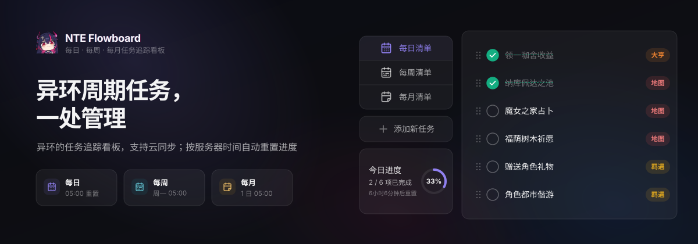
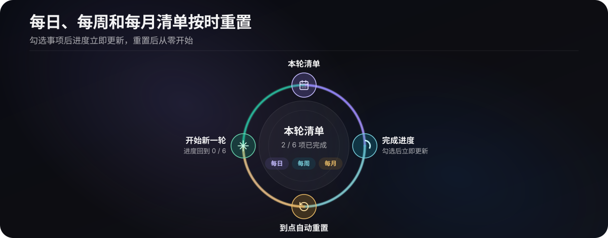

<p align="center">
  
</p>

<h1 align="center">NTE Flowboard</h1>

<p align="center">
  一块本地优先的《NTE》周期清单，记录每日、每周和每月事项
</p>

<p align="center">
  <a href="https://miponianyou.github.io/NTE-Flowboard/">在线使用</a>
  <span>&nbsp;·&nbsp;</span>
  <a href="#快速开始">本地运行</a>
  <span>&nbsp;·&nbsp;</span>
  <a href="#可选云端同步">云端同步</a>
</p>

<p align="center">
  
  
  
</p>

<p align="center">
  
</p>

> 选择服务器后照着清单完成事项；到达重置时间，系统会自动开始下一轮

## 每轮清单与进度

NTE Flowboard 把周期事项分成每日、每周和每月三份清单；你可以添加自己的任务、编辑标签、拖拽排序或暂时隐藏任务；完成的任务可自动移到清单末尾，进度环会显示本轮已完成的数量

| 周期 | 默认追踪内容                                     | 重置时点        |
| ---- | ------------------------------------------------ | --------------- |
| 每日 | 地图交互、咖舍收益、角色羁遇、像素与家具材料     | 每日 05:00      |
| 每周 | 异象巡礼、都市活力、宝库、送货、拍卖与通行证任务 | 每周一 05:00    |
| 每月 | 集市迷迭、大亨猎人、玩法异境等商店兑换           | 每月 1 日 05:00 |

<p align="center">
  
</p>

## 按服务器时间自动重置

- 可选择亚太服、美服或欧服；美服和欧服会自动处理夏令时
- 每日 05:00、每周一 05:00 和每月 1 日 05:00，分别重置对应清单
- 离线也能用；多个浏览器标签页会通过本地存储保持一致

## 数据默认留在你的浏览器里

清单和偏好默认保存在浏览器的 `localStorage` 中，不需要账户，也不依赖网络；首次加载时会自动迁移旧版 `nte-checklist-data` 数据

## 可选云端同步

需要跨设备使用时，在设置中填写你的 Supabase Project URL 与 Publishable Key：

```text
本地变更  →  IndexedDB 待同步队列  →  条件写入 RPC  →  Supabase
Supabase  →  pull_sync + 冲突合并               →  本地状态
```

支持 Background Sync 的 Chromium 浏览器会在页面关闭后尽力继续补传；其他浏览器会在页面重新打开后恢复同步。旧数据库会在云同步设置中显示一次性升级 SQL，执行后手动同步即可自动启用。

Project URL 与 Publishable Key 只保存在当前浏览器；启用后台补传后，它们也会写入浏览器的 IndexedDB，供同源 Service Worker 调用 Supabase。Publishable Key 是前端公开凭据，数据访问权限由 Supabase 的 Row Level Security (RLS) 控制；旧项目仍可使用 Anon Key

> 配置同步前，请先在 Supabase 项目中启用并验证 RLS；RLS 配置错误时，持有项目公开凭据的人可能读取或写入同步数据

## 快速开始

直接使用：<https://miponianyou.github.io/NTE-Flowboard/>

本地开发建议使用 Node.js 22.22.2；也支持 Node.js 24.15.0+ 和 26+：

```bash
git clone https://github.com/MiPoNianYou/NTE-Flowboard.git
cd NTE-Flowboard
npm install
npm run dev
```

## 开发与验证

| 命令                                | 作用                              |
| ----------------------------------- | --------------------------------- |
| `npm run dev`                       | 启动开发服务器                    |
| `npm run test`                      | 运行 Vitest 测试                  |
| `npm run test:watch`                | 监听测试变更                      |
| `npm run test:browser`              | 运行 Playwright 端到端测试        |
| `npm run test:integration:supabase` | 运行真实 Supabase 集成测试        |
| `npm run lint`                      | 检查 `src/` 与 `tests/`           |
| `npm run typecheck`                 | 运行 TypeScript 检查              |
| `npm run format:check`              | 检查格式                          |
| `npm run build`                     | 运行 lint、类型检查并生成生产构建 |

默认测试不会收集真实 Supabase 集成测试。需要验证 RPC 与 Realtime 时，请使用本地或独立的
Supabase 测试环境，并在当前终端设置环境变量后显式启用写入：

```powershell
$env:SUPABASE_TEST_URL='https://your-project.supabase.co'
$env:SUPABASE_TEST_PUBLISHABLE_KEY='sb_publishable_...'
$env:SUPABASE_TEST_ALLOW_WRITE='true'
npm run test:integration:supabase
```

缺少任一环境变量时，专用集成测试命令会直接失败；请勿使用生产项目运行该测试。

测试会临时替换名为 `NTE Flowboard` 的云端记录；完成 RPC 与 Realtime 验证后，测试会恢复原 JSON；恢复操作会刷新该记录的 `updated_at`

<details>
<summary>项目结构</summary>

```text
src/
  assets/           应用图标与 README 插图
  components/       界面与交互组件
  context/          全局设置状态
  hooks/            清单、同步、交互逻辑
  utils/            存储、迁移、时间与服务接口
  system.css        Liquid Glass 设计令牌
tests/
  components/       组件行为测试
  hooks/            Hook 行为测试
  integration/      可选的真实服务集成测试
  utils/            数据与工具契约测试
  e2e/              Playwright 端到端测试
```

</details>

## 技术栈

React 19 · TypeScript · Vite 8 · Tailwind CSS 4 · Motion · dnd-kit · Supabase · Vitest · Playwright

## 发布

推送到 `main` 后，GitHub Actions 会依次检查格式、运行测试、构建并部署到 GitHub Pages

<p align="center"><sub>MIT License</sub></p>
